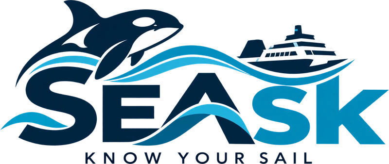

<p align="center">
  
</p>

# SEAsk

Ocean Hackathon 2026 · BC Ferries solution · [Presentation](https://canva.link/of8hitvmbj04wqo)

A BC Ferries ship on the Swartz Bay ↔ Tsawwassen route carries Ocean Networks Canada (ONC) instruments.
About once a second they record the ship's position and motion and the surface water it sails through:
temperature, salinity, oxygen, chlorophyll and turbidity. SEAsk shows that data, live or replayed from a
recorded day, on two screens.

- **Passenger kiosk.** A touch screen for visitors of every age, in English and French. A diver mascot
  shows them the live ferry in 3D on real terrain. From there they can dive under the ship to meet the
  animals at each depth, rewind the crossing on the route map, take an ocean quiz, or open the Ocean lab
  to see every reading, the tides and the weather.
- **Captain's bridge** (`/bridge`). A data-heavy chart for the crew that shows everything known about
  one moment of the day: own ship and ride comfort, surface currents (radar and model), measured and
  modelled wind, tides and the Active Pass current, AIS traffic with CPA / TCPA, the deep-water
  observatories, and the team's experimental biofouling hotspots. It follows today live or replays a
  recorded day. Advisory only, not for navigation.

## Quick start

You don't need any keys to start: the frontend alone replays the real recorded day (17 Aug 2026) from
bundled data and labels it "Recorded".

```sh
cd frontend
npm install
npm run dev            # http://localhost:5173 (the crew screen is at /bridge)
```

For live data, run the backend too. It needs a Neon connection string, an ONC token and an
OpenWeatherMap key (ask a teammate; see [DATA.md](DATA.md) §2):

```sh
cd backend
uv venv --python 3.12 .venv
uv pip install --python .venv/bin/python -r requirements.txt
cp .env.example .env   # fill in NEON_URL, ONC_TOKEN, OPENWEATHER_API_KEY
.venv/bin/python -m uvicorn main:app --reload    # http://localhost:8000/docs
```

Then set `VITE_LIVE_DATA=true` in `frontend/.env.local` and restart `npm run dev`. Keep API keys in
`backend/.env` only: anything in a `VITE_` variable ends up in the browser.

**Requirements:** Node 22.18 or newer (the frontend scripts run `.ts` files directly), Python 3.10+
(3.12 recommended) with [uv](https://docs.astral.sh/uv/). Docker only to build the map terrain.

**Map tiles** (about 270 MB, not in git) give the kiosk its real terrain and satellite map, and the bridge
its basemap. Without them the kiosk uses a stylized 3D sea instead. See
[frontend/README.md](frontend/README.md#map-mode-and-offline-tiles).

## Repository

| Path | What it is |
| --- | --- |
| [`frontend/`](frontend/) | The kiosk and the bridge. React 19 + TypeScript + Vite; CesiumJS for the map, three.js for the sea and the diver. |
| [`backend/`](backend/) | FastAPI. Live data from ONC, DFO, OpenWeatherMap, Open-Meteo, ECCC and SalishSeaCast; recorded days from Neon Postgres. |
| [`backend/scripts/`](backend/scripts/) | Build the derived and bridge tables in Neon, and export the kiosk's offline data. |
| [`frontend/public/data/`](frontend/public/data/) | Offline copy of the recorded day, used when the backend is down. |
| [`DATA.md`](DATA.md) | The hackathon data, the shared database and what the data shows. |
| [`SOURCES.md`](SOURCES.md) | Every value on screen, where it comes from, and how to credit it. |

More detail:

- [frontend/README.md](frontend/README.md): screens, settings, offline tiles, the bridge, and how to change text, landmarks and photos.
- [backend/README.md](backend/README.md): setup, every endpoint, and the scripts that build the data.

## Data

| What | Source |
| --- | --- |
| Ship position, motion and surface water | Ocean Networks Canada, instruments aboard BC Ferries vessels; the hackathon export of 17 Aug 2026 |
| Tides and the Active Pass current | Fisheries and Oceans Canada, Canadian Hydrographic Service |
| Weather and waves | OpenWeatherMap, Open-Meteo, Copernicus Marine |
| Measured wind | Environment and Climate Change Canada stations |
| Surface currents | ONC CODAR radar, SalishSeaCast (UBC), Mercator global model via Open-Meteo |
| Deep water and ship traffic | ONC VENUS observatories (SCVIP, SEVIP), ONC Iona AIS receiver |
| Seafloor depth | GEBCO 2026 |
| Map | EOX Sentinel-2 cloudless, NRCan base map and MRDEM-30 terrain |
| Biofouling index | SEAsk team machine-learning model (experimental, one run for 17 Aug 2026) |

Licences, citations and the credit text shown in the app are in [SOURCES.md](SOURCES.md).

## Status

SEAsk is a hackathon prototype. Before it goes on a ship:

- **Licences.** A kiosk on BC Ferries vessels may count as commercial use. EOX imagery is
  non-commercial (CC BY-NC-SA), the free Open-Meteo API is non-commercial, and the CHS tide licence
  forbids commercial derivative products. See [SOURCES.md §10](SOURCES.md#10-before-a-public-launch).
- **Written content.** The facts and the island knowledge are drafts (`"checked": false`). Someone on
  the team must verify each one with
  [`KNOWLEDGE_CHECKLIST.md`](frontend/src/mocks/KNOWLEDGE_CHECKLIST.md).
- **Diver model.** The 3D diver has no known author or licence. Confirm where it came from, or use the
  flat drawing that replaces it.
- **Biofouling index.** It is an unvalidated screening proxy from one model run. It ranks places on that
  day only.
- **Ask.** The diver and the bridge's Ask panel answer a set of canned questions, filled with the live
  values. A real assistant (`POST /api/ask`) is planned; see
  [backend/README.md](backend/README.md#planned-an-assistant-post-apiask).
